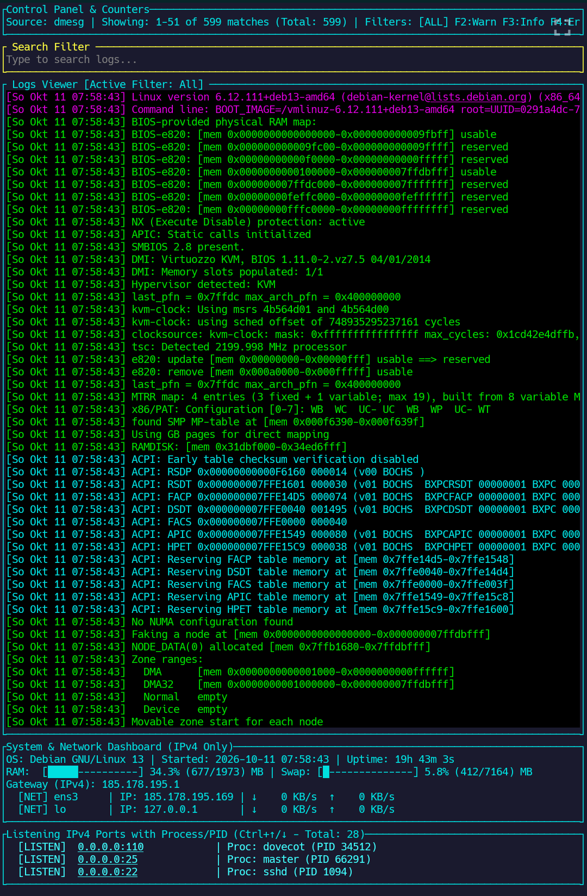
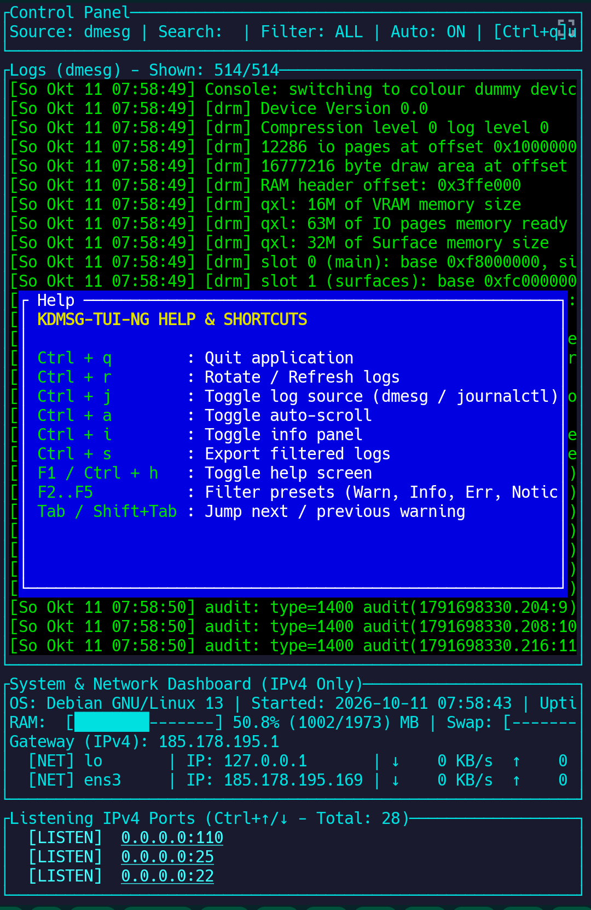

# kdmsg-tui-ng

**A TUI (Terminal User Interface) in Rust for searching and displaying kdmsg information**



## Features

- Interactive terminal interface for kdmsg data
- Search and filter capabilities
- Systemd service integration
- Help system with F1 key

## Installation

### Prerequisites

- Rust toolchain (for building from source)
- Meson build system
- systemd (for service management)

### Quick Installation

1. Clone the repository:
   ```sh
   git clone https://github.com/NAZY-OS/kdmsg-tui-ng.git
   cd kdmsg-tui-ng
   ```

2. Make the build script executable:
   ```sh
   chmod +x build.sh
   ```

3. Run the installation script:
   ```sh
   ./build.sh
   ```

4. Install the system service:
   ```sh
   sudo systemctl daemon-reload
   sudo systemctl enable --now kdmsg-tui.service
   ```

### Manual Installation (Alternative)

If you prefer to build manually:

```sh
meson setup build
sudo meson install -C build
sudo systemctl daemon-reload
sudo systemctl enable --now kdmsg-tui.service
```

## Usage

- Launch the application with: `kdmsg-tui-ng`
- Press **F1** for help
- Use arrow keys to navigate
- Press **q** to quit

## Screenshots



## License

[MIT License](LICENSE) (Add your actual license file if different)

## Contributing

Pull requests are welcome. For major changes, please open an issue first to discuss what you would like to change.

## Support

For issues or questions, please open a GitHub issue.
